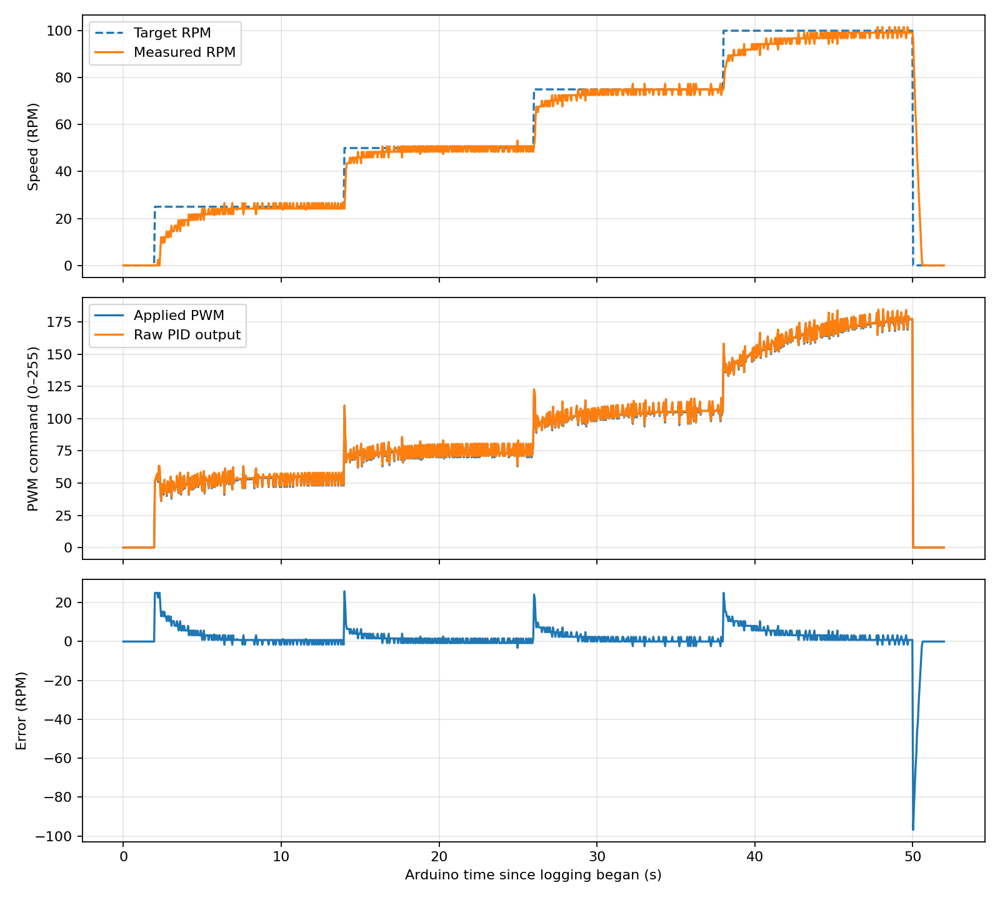

# DC Motor PID Control & Automated Validation

## Overview

Designed and implemented an embedded closed-loop speed controller for a geared DC motor using an Arduino Uno, encoder feedback, and PWM motor actuation.

Developed a Python-based automated validation framework to execute repeatable speed-step tests, log real-time motor telemetry, and quantitatively evaluate controller performance.

## Hardware

- Arduino Uno
- DC geared motor with incremental encoder
- PWM motor driver
- External DC power supply
- USB serial connection to host PC

## Hardware Setup

The experimental setup consists of an Arduino Uno, a DC geared
motor with an incremental encoder, a PWM motor driver, and an
external power supply.


## Control System

The embedded controller implements proportional-integral-derivative (PID) speed regulation:

$$
u(t)=K_pe(t)+K_i\int e(t)\,dt+K_d\frac{de(t)}{dt}
$$

Key implementation details:

- 20 Hz nominal control-loop frequency
- Interrupt-driven encoder feedback
- Encoder resolution calibrated to 496 ticks per output-shaft revolution
- PWM motor actuation
- Integral anti-windup
- USB serial communication for setpoint commands and telemetry

## Automated Validation

The Python test framework communicates with the Arduino over USB serial and automates motor-speed experiments.

Features include:

- Programmable RPM setpoints
- Repeatable speed-step sequences
- CSV measurement logging
- Target-versus-measured RPM plots
- PID control effort visualization
- Rise time, overshoot, settling time, and steady-state error calculations

## Experimental Results

The controller was evaluated at four speed setpoints: 25, 50, 75, and 100 RPM.

The measured responses demonstrated stable tracking, minimal visible overshoot, and no sustained PWM saturation during the tested operating conditions.



## Running the Tests

Install dependencies:

```bash
pip install -r requirements.txt
```

Run automated validation:

```bash
python python/run_tests.py --port COM5 --speeds 25 50 75 100 --duration 12
```

The serial port may differ depending on the connected computer.

## Limitations

- Encoder quantization affects low-speed measurements.
- The controller was validated over a limited range of operating conditions.
- No independent motor-current measurement was implemented.
- The current firmware does not include a communication-loss watchdog.
- Testing was performed using a benchtop experimental setup.

## Future Improvements

- Automated comparison of different PID gains
- Disturbance-rejection testing
- Controller performance regression testing
- Software-based fault detection
