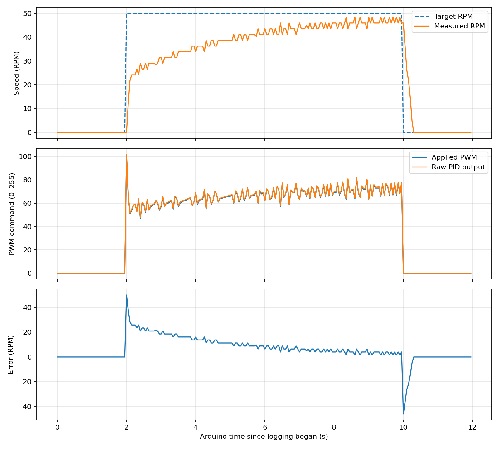

# DC motor PID automated validation

Source CSV: `pid_test_20261123_151756.csv`

## Step metrics

| status   |   target_rpm |   rise_time_s |   overshoot_pct |   settling_time_s |   steady_state_error_rpm |   saturation_pct |   samples | phase   |
|:---------|-------------:|--------------:|----------------:|------------------:|-------------------------:|-----------------:|----------:|:--------|
| ok       |           50 |         4.391 |               0 |               nan |                  3.50062 |                0 |       160 | step_1  |

Metrics are estimated from encoder measurements sampled at approximately 20 Hz. Rise time, overshoot, settling time, and steady-state error characterize the closed-loop response. The 2% settling metric may be undefined because of encoder quantization or measurement noise.

